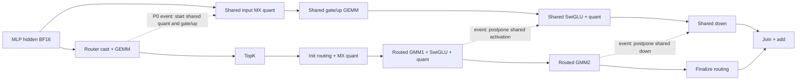

# 第二轮：显式流调度与资源实验

当前是 eager/显式 NPU stream/event 路径，没有 TorchAir GE 编译或自动重排。按 model-infer-multi-stream 技能先核对 Stream ID，再核对时间线交集；大批次真实重叠已成立，小尾批次多数物理串行。没有把无收益直接归因为 host 或 allocator。

## DAG 与候选

图中展示 P0。数据边为实线；虚线是为资源互补而增加的 event 约束。P1 把 Router→input quant 的 event 改为 Router→gate/up，使 input quant 可提前执行。attention/KV、下一层与本层输出之间保留原数据依赖。

- P0（既有三阶段）：Router 后共享流执行 input quant + gate/up；其后两个共享阶段分别等 GMM1、GMM2。
- P1（提前量化）：input quant 与 Router 并行，gate/up GEMM 仍等 Router 后与 TopK/init 并行；激活和 down 仍严格保持用户指定的后两阶段。
- C2（实施强度，不是新 DAG）：对共享流施加 cube/vector 上限；主流不设限，因此不是固定主副流硬件分区。
- 选择器：可按 prefill token 数设门槛，小输入可回到原串行实现。代码默认门槛为 0，本轮推荐显式设置 8192。

执行所有候选前检查作用域、事件顺序与 tensor 生命周期。输入/输出继续使用 record_stream，权重常驻；没有为了减少分配开销删除内存安全同步。

## 实测与选择

实际芯片 `Ascend950DT_9582`，stream 默认资源上限为 32 cube、64 vector。客户 profiling 中 main TopK/init/finalize 均为 64 vector block，routed GMM2 为 32 cube block，共享流默认同样使用较多资源。

组件实验在物理 5 号卡独占运行，使用 GLM 相同的 64 专家、top-k=4、2048/3072/1536 维度及同一套 NPU router、init、GMM、finalize 算子，数值为固定种子的合成 fixture。合成组件仅用于候选筛选，不能代替真实权重的客户 TTFT 或 GSM8K。

每个配置先预热 5 次，再计时 15 次。44 个 shape/config 组合全部与串行 fixture 输出逐位一致，max_abs=0。

| token 数 | 串行中位数 | P0 三阶段 | P1 提前量化 | P0 副流 24 cube/32 vector |
| --- | ---: | ---: | ---: | ---: |
| 1606 | 0.6722 ms | 0.6463 ms | 0.6819 ms | 0.6977 ms |
| 8192 | 1.8569 ms | 1.6961 ms | 1.7273 ms | 1.7449 ms |
| 30861 | 6.4988 ms | 5.8173 ms | 5.9053 ms | 5.8328 ms |
| 32768 | 6.9456 ms | 6.2297 ms | 6.2540 ms | 6.2130 ms |

8 cube 的配置会明显拖慢大输入，提前量化也未稳定超过 P0。暂时保留 P0、不限核作为默认调度，实验选项默认关闭。不能据此宣称取得 10% 端到端 TTFT 收益：10% 是合成 MoE 组件，不包含 attention、调度和请求层。

## 可复算选项

- `SGLANG_NPU_SHARED_EXPERT_OVERLAP_PREQUANT=1`：P1。
- `SGLANG_NPU_SHARED_EXPERT_OVERLAP_CUBE_CORES` / `..._VECTOR_CORES`：副流上限，默认 -1（硬件默认）；只接受有效核数。
- `SGLANG_NPU_SHARED_EXPERT_OVERLAP_MIN_TOKENS`：门槛，默认 0。
- `tune_component.py --output <path>`：完整 44 组合 fixture。
- `component-tuning.json`：全部原始计时和数值检查。

## 匹配 allocator 与选择器的真实模型结果

两版都设置 `PYTORCH_NPU_ALLOC_CONF=expandable_segments:True`，其余模型、输入及测量方式相同。每版新服务启动、预热 3 个客户请求组，再计时全部 2000 条请求 / 248 组；没有剔除慢样本。

| 配置 | 平均 TTFT | P50 | P95 | 全部 burst 耗时 |
| --- | ---: | ---: | ---: | ---: |
| 串行基线 | 899.505 ms | 915.780 ms | 1012.993 ms | 232.151 s |
| P0，全量 prefill 并行 | 868.400 ms | 890.071 ms | 984.429 ms | 224.632 s |
| P0，token 门槛 8192 | 862.426 ms | 882.213 ms | 980.298 ms | 223.106 s |

P0 平均 TTFT 降低 3.458%，246/248 组变快；门槛版本降低 4.122%，248/248 组变快，配对组平均节省 36.474 ms，按组 bootstrap 95% 区间 [34.372,38.676] ms。两版的 2000 个输出 token 全部一致。该区间描述本次请求组变异，不能代替不同运行顺序的重复实验。

不能据此断言 allocator 是旧实验慢批次的根因：两版同时使用新 allocator，且测量运行次序也发生变化。反向顺序复测也已完成：平均 TTFT 891.591→873.732 ms（降低 2.003%），P95 1008.035→985.070 ms（降低 2.278%），burst 耗时 230.243→225.912 s。232/248 组变快，2000/2000 输出 token 一致；配对组平均节省 17.462 ms，bootstrap 95% [16.110,18.801] ms。两轮平均 TTFT 收益范围 2.00%–4.12%，反映了运行间变化，不保证固定收益幅度。

每版 profiling 采集相同客户组 5 次，丢前 2 次，按剩余 3 次 × 46 层统计：

| token 数 | 串行 MLP 中位数 | P0 MLP 中位数 | 门槛版 MLP 中位数 |
| --- | ---: | ---: | ---: |
| 1606 | 1209.750 us | 1577.149 us | 1281.055 us |
| 30861 | 6393.133 us | 5797.436 us | 5794.706 us |

30861-token 的 138 个层实例在三阶段的 overlap_pct 均达到 0.5，中位数均为 1.0；1606-token 尾批次在 P0 中多数物理串行，门槛版直接回退原实现。大批次主流 init/GMM2/finalize 平均仍从 1377/956/343 us 增至 1447/1057/404 us，说明并发竞争没有消失；但整个 MLP 从约 6.39 ms 降到 5.79 ms。

`analyze_moe_windows.py` 从实际 AddRmsNorm 结束到最终 shared+routed Add 结束重建 MLP 窗口，并按交集 / min(两侧窗口) 计算重叠率。逐层数据及被丢弃的前两次记录都保留在 CSV 中。毛重叠时间没有相加当作 TTFT 收益。

最终完整 GSM8K 使用单独的新 journal，原先的 100 条基线和 44 条旧优化结果保持原样。两组都使用相同的 decode graph、并发 32、4-shot、greedy、最多 8192 输出；prefill 继续 eager。这样只加速精度任务的执行，不将质量测试延迟混入客户 TTFT 对照。

完整 GSM8K 最终两组均为 1170/1319（88.7036%），相同的 15 个截断样本均保留计分；1319 条完整文本全部一致，独立重评分覆盖 2638 条回答。详见最终性能报告。
