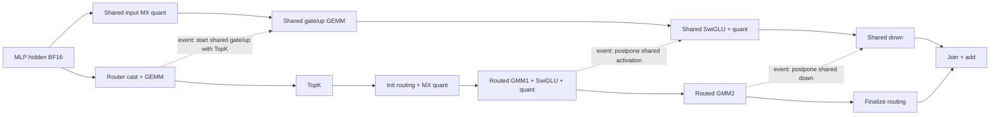

# 第二轮：显式流调度与资源实验

当前是 eager/显式 NPU stream/event 路径，没有 TorchAir GE 编译或自动重排。按 model-infer-multi-stream 技能先核对 Stream ID，再核对时间线交集；大批次真实重叠已成立，小尾批次多数物理串行。没有把无收益直接归因为 host 或 allocator。

## DAG 与候选

数据边为实线；虚线是为资源互补而增加的 event 约束。attention/KV、下一层与本层输出之间保留原数据依赖。

- P0（既有三阶段）：Router 后共享流执行 input quant + gate/up；其后两个共享阶段分别等 GMM1、GMM2。
- P1（提前量化）：input quant 与 Router 并行，gate/up GEMM 仍等 Router 后与 TopK/init 并行；激活和 down 仍严格保持用户指定的后两阶段。
- C2（实施强度，不是新 DAG）：对共享流施加 cube/vector 上限；主流不设限，因此不是固定主副流硬件分区。
- 选择器：可按 prefill token 数设门槛，小输入可回到原串行实现。默认门槛为 0，本轮尚未选择新的默认值。

执行所有候选前检查作用域、事件顺序与 tensor 生命周期。输入/输出继续使用 record_stream，权重常驻；没有为了减少分配开销删除内存安全同步。

## 实测与选择

实际芯片 `Ascend950DT_9582`，stream 默认资源上限为 32 cube、64 vector。客户 profiling 中 main TopK/init/finalize 均为 64 vector block，routed GMM2 为 32 cube block，共享流默认同样使用较多资源。

组件实验在物理 5 号卡独占运行，使用 GLM 相同的 64 专家、top-k=4、2048/3072/1536 维度及同一套 NPU router、init、GMM、finalize 算子，数值为固定种子的合成 fixture。合成组件仅用于候选筛选，不能代替真实权重的客户 TTFT 或 GSM8K。

每个配置先预热 5 次，再计时 15 次。44 个 shape/config 组合全部与串行 fixture 输出逐位一致，max_abs=0。

| token 数 | 串行中位数 | P0 三阶段 | P1 提前量化 | P0 副流 24 cube/32 vector |
| --- | ---: | ---: | ---: | ---: |
| 1606 | 0.6722 ms | 0.6463 ms | 0.6819 ms | 0.6977 ms |
| 8192 | 1.8569 ms | 1.6961 ms | 1.7273 ms | 1.7449 ms |
| 30861 | 6.4988 ms | 5.8173 ms | 5.9053 ms | 5.8328 ms |
| 32768 | 6.9456 ms | 6.2297 ms | 6.2540 ms | 6.2130 ms |

8 cube 的配置会明显拖慢大输入，提前量化也未稳定超过 P0。暂时保留 P0、不限核作为默认调度，实验选项默认关闭。不能据此宣称取得 10% 端到端 TTFT 收益：10% 是合成 MoE 组件，不包含 attention、调度和请求层。

## 可复算选项

- `SGLANG_NPU_SHARED_EXPERT_OVERLAP_PREQUANT=1`：P1。
- `SGLANG_NPU_SHARED_EXPERT_OVERLAP_CUBE_CORES` / `..._VECTOR_CORES`：副流上限，默认 -1（硬件默认）；只接受有效核数。
- `SGLANG_NPU_SHARED_EXPERT_OVERLAP_MIN_TOKENS`：门槛，默认 0。
- `tune_component.py --output <path>`：完整 44 组合 fixture。
- `component-tuning.json`：全部原始计时和数值检查。

下一项是匹配 allocator 的真实模型对照：两版都设置 `PYTORCH_NPU_ALLOC_CONF=expandable_segments:True`，保持相同 P0 调度、模型和输入。allocator 是否解释慢批次仍待实测，不能把它当成已证实根因。GSM8K 已完成的 100 条基线记录和 44 条旧优化记录保持落盘；最终还需恢复全量验证。
